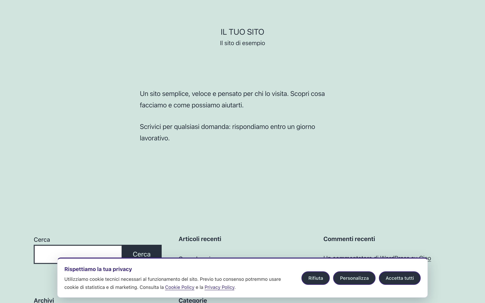
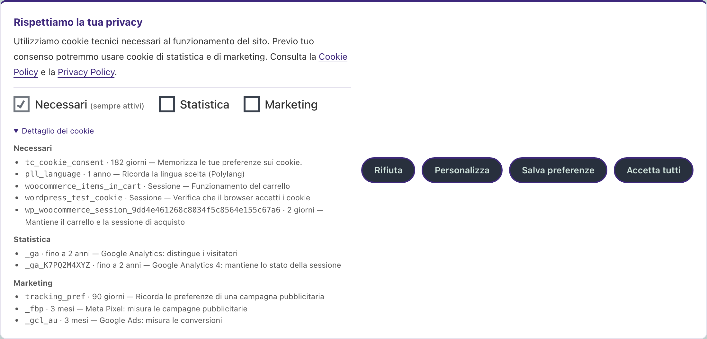
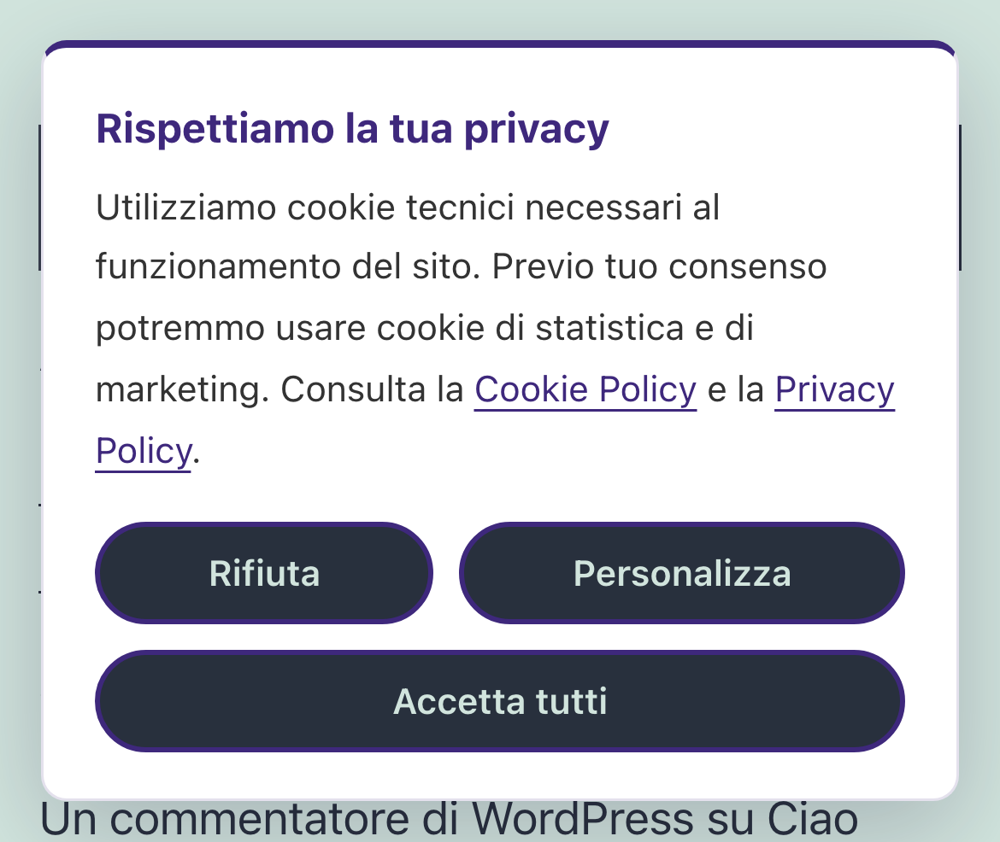
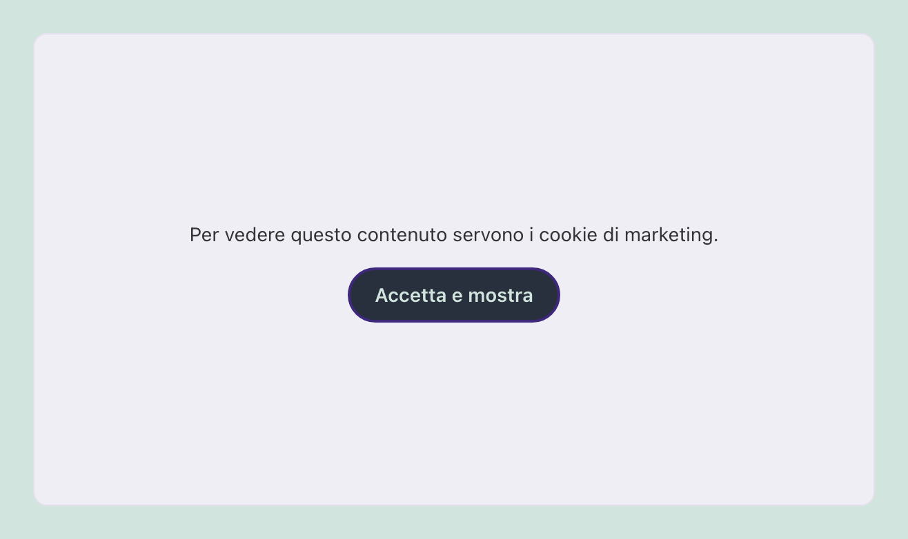
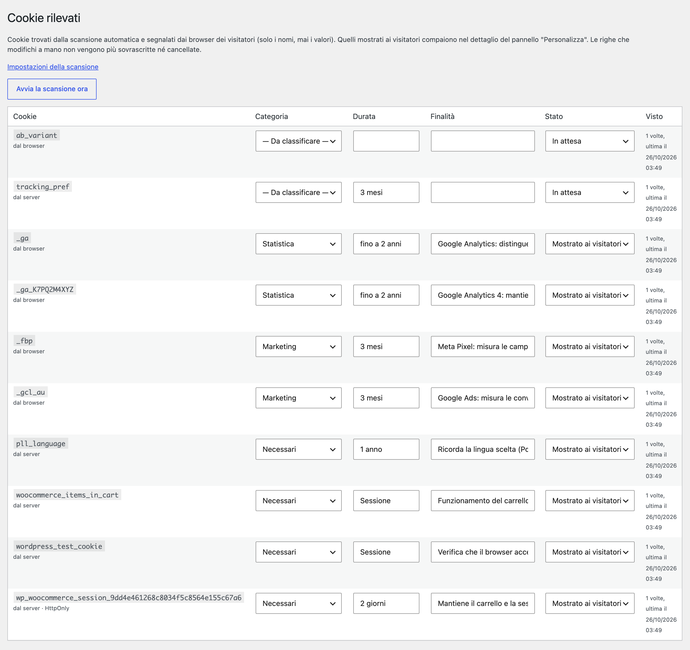

# Threecommerce Cookie Banner: GDPR cookie consent banner for WordPress

A lightweight, self-contained GDPR cookie consent banner for WordPress: no external service, no subscription, vanilla JavaScript without jQuery. It is the WordPress version of our Magento 2 cookie banner.

**Compatibility:** WordPress 6.0+ · PHP 8.1 – 8.4
**License:** free · **Current version:** see [Releases](../../releases)

## Features

- Three consent categories: **Necessary** (always on), **Statistics** and **Marketing**, with *Accept all*, *Reject*, *Customize* and *Save preferences* buttons.
- Consent stored in a first-party cookie (`tc_cookie_consent`, versioned, about six months, `SameSite=Lax`, `Secure` on HTTPS). **No cookie is set before the visitor chooses.**
- **Prior blocking** of third-party scripts until consent is given.
- Optional **Google Consent Mode v2**: `analytics_storage`, `ad_storage`, `ad_user_data` and `ad_personalization` denied by default and updated on choice.
- **Third-party embeds blocked** (YouTube, Vimeo, Google Maps, Facebook, Instagram, TikTok, Twitch, Spotify, SoundCloud): a placeholder with an "Accept and show" button replaces them until marketing consent.
- Reopen the preferences from anywhere: `[tc_cookie_settings]` shortcode, `#cookie-preferences` link, a `data-cookie-settings` element or `window.TcCookieConsent.open()`.
- **Page cache friendly** (LiteSpeed, WP Super Cache...): the page is the same for everyone, the choice lives only in the cookie read by the browser.
- **Automatic cookie scanner**: every night the plugin visits the home page and the pages you list like a new visitor and reads the cookies set by the server (HttpOnly too); the banner also reports the names of the cookies found in the browser. A dictionary classifies the common ones.
- Optional **consent log** to prove consent (GDPR art. 7.1), with a filterable list and CSV export.
- **Translated cookie policy link** with WPML or Polylang. Accessible dialog (focus management, `Esc`, visible focus, reduced motion). Translatable texts, English included.

## Requirements

- WordPress 6.0 or newer
- PHP 8.1 – 8.4

## Installation

The plugin is free. Get the zip from the [product page](https://www.threecommerce.it/cookie-banner-gdpr-wordpress?utm_source=github&utm_medium=readme&utm_campaign=wordpress-cookie-banner) (free order, then download it from My Account), then in WordPress go to **Plugins → Add New → Upload Plugin**, upload the zip and activate it.

## Configuration

WordPress admin → **Settings → Cookie Banner**: privacy and cookie policy pages, embed blocking, main color, position, Google Consent Mode v2, consent cookie name, duration and version (raise it to ask everybody again), cookie list and scanner. Scan results are in **Settings → Detected cookies**.

## Documentation and support

- Product page and download: [threecommerce.it/cookie-banner-gdpr-wordpress](https://www.threecommerce.it/cookie-banner-gdpr-wordpress?utm_source=github&utm_medium=readme&utm_campaign=wordpress-cookie-banner)
- [Changelog](CHANGELOG.md) (in Italian)
- Support and custom development: [threecommerce.it/contatti](https://www.threecommerce.it/contatti?utm_source=github&utm_medium=readme&utm_campaign=wordpress-cookie-banner)

---

*This repository is the public showcase of the plugin. The source code is kept in a private repository.*
